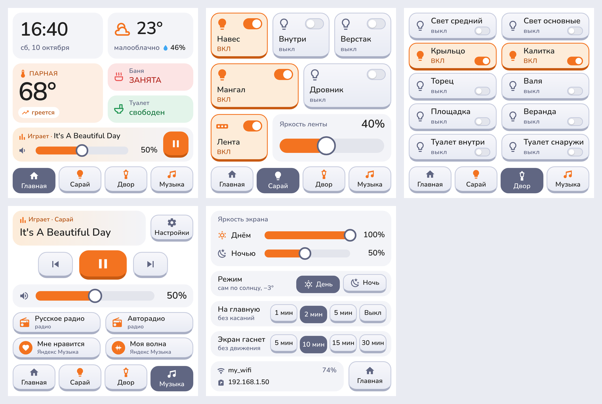
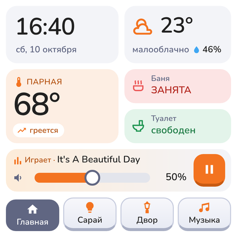
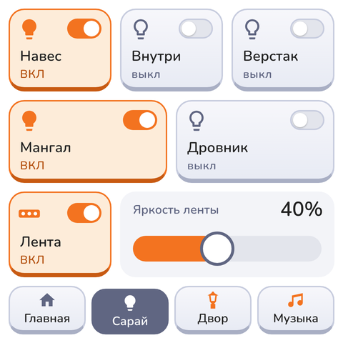
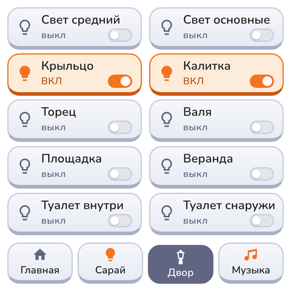
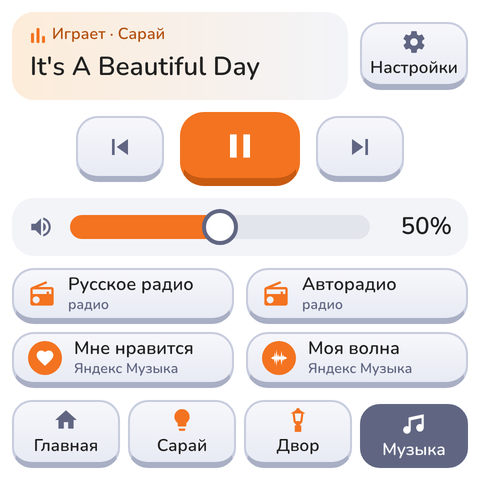
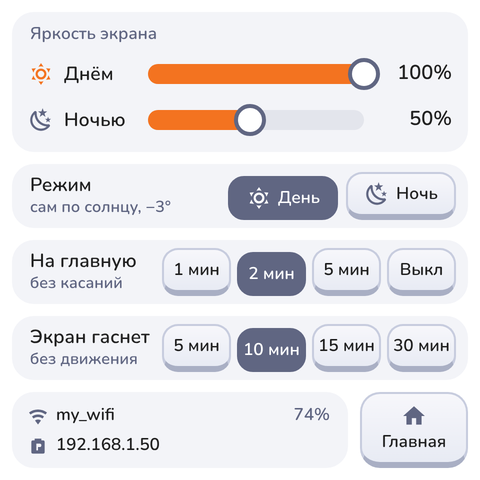
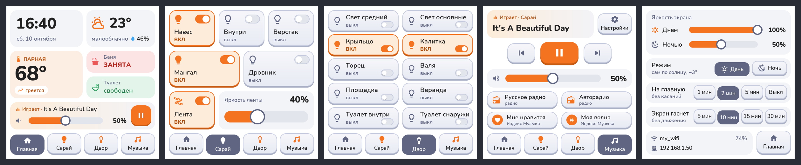
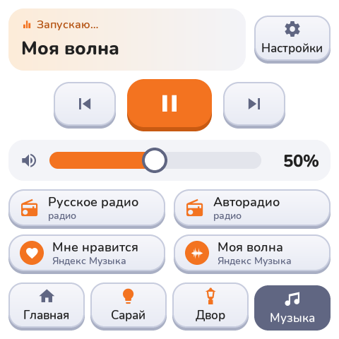

# Панель «Сарай» — сенсорная панель Home Assistant на ESPHome + LVGL

Прошивка для **Guition ESP32-S3-4848S040** (4", 480×480, ST7701S + тач GT911):
пульт для сарая на даче — свет в помещении и во дворе, баня, погода и музыка
через Music Assistant. Всё рисуется LVGL 9 на самой панели, данные и действия —
из Home Assistant по нативному API ESPHome.

> **Сделано для себя.** Это панель для моей дачи, а не готовый продукт: она
> работает у меня на моём железе и моих сущностях HA. Прошивка, генератор,
> макеты и документация сделаны вместе с **Claude Code (модель Claude Opus 5.5)**:
> я ставил задачи, проверял на панели и в HA, Claude писал код.
> Автор — [peholod009](https://github.com/peholod009). Выкладываю как есть — бери, переделывай под себя.



<sub>Макеты экранов. Прошивка сгенерирована из них пиксель в пиксель —
ниже есть рендер настоящей LVGL для сравнения.</sub>

---

## Экраны

| | |
|---|---|
|  | **Главная.** Часы и дата; погода (иконка, температура, состояние, влажность); температура парной с трендом «греется / остывает / стабильно»; занятость бани и туалета; мини-плеер: трек, громкость слайдером, пауза. |
|  | **Сарай.** 5 выключателей света + LED-лента с яркостью. Плитка подсвечивается оранжевым, когда свет горит. |
|  | **Двор.** 10 выключателей уличного света на весь экран (свет с разных ESP-реле бани, хаты, туалета). |
|  | **Музыка.** Что играет и где; назад / пауза / вперёд; громкость; 4 кнопки быстрого запуска: 2 радиостанции и 2 плейлиста Яндекс Музыки. Отсюда же вход в настройки. |
|  | **Настройки.** Яркость днём и ночью, режим день/ночь, через сколько вернуться на главную, через сколько гаснет экран, Wi-Fi и IP. Без таб-бара — своя кнопка «Главная». |

Так выглядит настоящая прошивка (LVGL, отрисовано на ПК через SDL, данные подставные):



---

## Что умеет

* **5 экранов**: 4 во вкладках внизу (+ свайп), «Настройки» — только с «Музыки».
* **Настройки синхронизированы с HA.** Всё, что на экране настроек, — это
  обычные сущности ESPHome (`number` / `select`). Поменял на панели — изменилось
  в HA, и наоборот. Значения переживают перезагрузку.
* **Яркость по солнцу.** Солнце считает сама панель (компонент `sun`, координаты
  из `secrets.yaml`). Ниже −3° — ночная яркость, выше — дневная. Порог тот же,
  что у автоматизации света; меняется подстановкой `night_sun_elevation`.
  Режим можно переключить и вручную — до следующего восхода/заката.
* **Автовозврат на главную** через 1 / 2 / 5 мин без касаний (или выкл).
* **Гашение экрана по движению** — делает HA (датчики движения + камера Frigate),
  время берётся из настройки панели «Экран гаснет через».
* **Тёмный экран не нажимается.** Пока подсветка выключена, LVGL на паузе:
  первое касание только будит экран, а не включает свет вслепую.
* **Музыка без «через раз».** Кнопки радио/плейлистов вызывают скрипт HA, который
  отсекает повторные нажатия и повторяет запуск, если Music Assistant не
  успел. Панель сразу пишет «Запускаю…».
* **Обход бага ESPHome с ST7701S** — экран загорается после OTA и Restart без
  передёргивания питания (см. «Известные проблемы»).

---

## Железо и софт

| | |
|---|---|
| Панель | Guition ESP32-S3-4848S040 (продаётся также как Sunton ESP32-4848S040, «4 inch 86 box smart display»); у меня вариант C_I, 16 МБ flash, 8 МБ PSRAM. **Не Waveshare** — у Waveshare похожая ESP32-S3-Touch-LCD-4, но разводка другая |
| ESPHome | ≥ 2026.7 (проверено на 2026.7.3 и 2026.9.1) |
| Библиотека | [agillis/esphome-modular-lvgl-buttons](https://github.com/agillis/esphome-modular-lvgl-buttons) (MIT), проверено на коммите `7ea7fed` |
| Home Assistant | с интеграцией ESPHome; для музыки — Music Assistant |
| Интернет при сборке | MDI-иконки качаются с GitHub, шрифт Nunito — с Google Fonts |

---

## Сборка и прошивка

```bash
git clone https://github.com/peholod009/esphome-4848s040-ha-panel
cd esphome-4848s040-ha-panel/firmware

# библиотека должна лежать рядом с yaml — пути в packages относительные
git clone https://github.com/agillis/esphome-modular-lvgl-buttons
git -C esphome-modular-lvgl-buttons checkout 7ea7fed   # проверенная версия

cp secrets.yaml.example secrets.yaml   # и заполни
esphome config panel-saray.yaml         # проверка конфигурации
esphome run panel-saray.yaml            # сборка + прошивка
```

1. **Первая прошивка — по USB-C.** Если порт не виден — зажми BOOT, нажми RST
   (или подключи кабель с зажатой BOOT). Дальше — по воздуху (OTA).
2. В `secrets.yaml` (пример — `secrets.yaml.example`): Wi-Fi, пароль точки
   доступа, ключ API (там же команда генерации), **координаты** — без них не
   посчитается солнце.
   Совет: в прошивке OTA без пароля (защищён только API-ключом). Если сеть
   не только твоя — добавь в `ota:` строку `password: !secret ota_password`.
3. **В HA добавь устройство** (ESPHome находится сам) и включи
   **«Allow the device to perform Home Assistant actions»**
   (Настройки → Устройства и службы → ESPHome → панель → Настроить).
   Без неё нажатия на панели не выполняются.
4. Создай хелперы, автоматизации и скрипт из [`home-assistant/`](home-assistant/README.md).

`secrets.yaml` в git не попадает (`.gitignore`), библиотека — тоже.

---

## Структура репозитория

```
firmware/
  panel-saray.yaml          готовая прошивка (сгенерирована tools/gen_panel.py)
  secrets.yaml.example      шаблон секретов
home-assistant/
  README.md                 как устроены экран и музыка на стороне HA
  helpers.md                таймер экрана, датчики тренда температуры
  automation_screen_on.yaml / automation_screen_off.yaml
  script_music_quick_start.yaml
tools/
  gen_panel.py              генератор прошивки — менять экраны здесь
  make_sdl.py, shoot.sh     превью на ПК без железа
docs/
  screenshots/              макеты и рендеры
  LLM_PROMPT.md             промт, чтобы LLM собрала панель под твой дом
```

---

## Как подставить свои сущности

Прошивка знает только эти сущности HA. Замени их на свои — либо в генераторе
(`tools/gen_panel.py`, рекомендуется), либо поиском по `firmware/panel-saray.yaml`.

| На экране | Моя сущность | Что ожидается |
|---|---|---|
| Свет «Сарай» (5 плиток) | `light.sarai_troitskaya_saray_relay_light_1…5` | любой `light` / `switch`* |
| LED-лента и её яркость | `light.troitskaya_saray_led_saray` | `light` с яркостью |
| Свет «Двор» (10 плиток) | `light.bania_…_relay1/3/4/5`, `light.khata_…_relay_light_1/3/4`, `light.troitskaya_banya_banya_relay2`, `light.tualet_…_relay1/2` | любой `light` / `switch`* |
| Парная | `sensor.troitskaya_banya_banya_temperature` | число, °C |
| Тренд парной | `sensor.bania_temperatura_trend` | `rising` / `falling` / иное (см. helpers.md) |
| Баня / Туалет | `sensor.zaniatost_bani_2`, `sensor.zaniatost_tualeta_2` | текст, начинающийся с «Занят…» / «Свобод…» |
| Погода | `weather.forecast_troitskaia` | любая `weather` (Met.no и т.п.) |
| Плеер | `media_player.sarai` | плеер Music Assistant |
| Кнопки музыки | `script.sarai_muzyka_bystryi_zapusk` | скрипт из `home-assistant/` |

<sub>* Плитки вызывают `light.toggle`. Для `switch` поменяй домен в генераторе
(или оберни выключатель в «Свет из выключателя» в HA).</sub>

**Через генератор:**

```bash
# поправь списки LIGHTS / YARD / PRESETS и entity_id в tools/gen_panel.py
python3 tools/gen_panel.py firmware/panel-saray.yaml
esphome config firmware/panel-saray.yaml
```

В `LIGHTS` и `YARD` у каждой плитки — id виджета, подпись, `entity_id`, иконка.
Число плиток заложено в сетку (5+лента и 10): если у тебя иначе — поменяй сетку
или отдай это LLM (см. ниже). Подробно — [`tools/README.md`](tools/README.md).

Новые подписи на русском — проверь, что буквы есть в шрифтах (в прошивке
кириллица подключена целиком через `glyphsets`, а вот MDI-иконки перечислены
списком — новую иконку нужно добавить в `mdi_font`).

---

## Что настраивается

**В прошивке (`substitutions`):**

| Параметр | По умолчанию | Что |
|---|---|---|
| `name` / `friendly_name` | `panel-saray` / «Панель Сарай» | имя устройства (влияет на id в HA) |
| `rotation` | `90` | поворот экрана (зависит от того, как висит панель) |
| `night_sun_elevation` | `-3` | высота солнца, ниже которой — ночной режим |
| палитра | словарь `C` в генераторе | цвета: оранжевый `#F37320`, серо-синий `#606682` |

**С экрана настроек / из HA** (у меня панель в комнате «Сарай», поэтому
id начинаются с `sarai_panel_sarai_`; у тебя будет `<комната>_<имя>_…`):

| Настройка | Сущность | Значения |
|---|---|---|
| Яркость днём | `number.…_iarkost_dnem` | 10–100 %, по умолчанию 100 |
| Яркость ночью | `number.…_iarkost_nochiu` | 5–100 %, по умолчанию 50 |
| Режим день/ночь | `select.…_brightness_mode` | Day / Night (сам по солнцу) |
| На главную без касаний | `select.…_vozvrat_na_glavnuiu` | 1 мин / 2 мин / 5 мин / Выкл |
| Экран гаснет без движения | `number.…_ekran_gasnet_cherez` | 1–60 мин, по умолчанию 10 (читает HA) |
| Подсветка | `light.…_display_backlight` | ей управляют автоматизации гашения |

---

## Сторона Home Assistant

Подробно, с готовым YAML — [`home-assistant/README.md`](home-assistant/README.md).
Коротко:

**Гашение экрана.** Панель сама экран не гасит (таймаут библиотеки выключен),
этим занимается HA:

```
движение / человек в кадре ──► «Экран ВКЛ» ──► включить подсветку (если кто-то дома)
                                   └─► запустить timer на N мин (N = настройка панели)
timer закончился ──► «Экран ВЫКЛ» ──► кто-то ещё в сарае? ── да ─► продлить таймер
                                                          └ нет ─► выключить подсветку
```

Яркость при включении выбирает панель (дневная/ночная), автоматизация её не
передаёт — иначе HA и панель спорят. Касание тёмного экрана тоже включает
подсветку, и «Экран ВКЛ» запускает таймер, так что экран не останется гореть.

**Музыка.** Плеер — любой плеер Music Assistant (у меня колонка на ESPHome,
звук приходит по протоколу Sendspin). Как работает:

* **Пауза, вперёд/назад, громкость** — панель напрямую вызывает
  `media_player.media_play_pause / media_next_track / media_previous_track /
  volume_set`. Название трека, состояние и громкость читает из атрибутов плеера.
* **Кнопки быстрого запуска** вызывают один скрипт с параметром `preset`:

```
кнопка ──► script.sarai_muzyka_bystryi_zapusk (preset: russkoe | avto | nravitsya | volna)
             mode: single — пока музыка стартует, повторные нажатия игнорируются
             ├─ music_assistant.play_media (enqueue: replace)
             └─ параллельно ждём смены трека 12 с → не сменился → ещё одна попытка
панель ───► сразу пишет «Запускаю…» + название, пока HA не пришлёт новый трек
```

* Адреса живут **только в скрипте**: радио — `library://radio/N` из библиотеки
  MA или прямая ссылка на поток (`media_type: radio`), плейлисты —
  `library://playlist/N` (у меня «My Favorites» и «My Wave» из Яндекс Музыки).
  Свои номера — `music_assistant.get_library` в Инструментах разработчика.
  Поменять станцию = поправить скрипт, перепрошивать панель не нужно.
* Зачем так сложно: при прямом вызове из прошивки люди жмут повторно, команды
  накладываются, и MA отвечает `MediaNotFoundError`/`QueueEmpty`; «Моя волна»
  иногда отдаёт пустую порцию треков. Скрипт это лечит.



---

## Известные проблемы и ограничения

* **Чёрный экран после OTA / Restart (ST7701S).** ESPHome шлёт программный
  сброс контроллеру без паузы, и после «тёплой» перезагрузки контроллер
  не принимает настройку — экран тёмный до передёргивания питания.
  Исправлено в ESPHome [PR #17646](https://github.com/esphome/esphome/pull/17646)
  (ожидается в 2026.10). До этого в прошивке стоит обход — блок
  «ОБХОД БАГА ESPHome» в `display:` (пауза 120 мс + повтор инициализации).
  После обновления ESPHome его можно удалить.
* **Сторонние потоки радио** живут своей жизнью: прошлый адрес «Авторадио»
  (101.ru) однажды просто перестал отвечать (404). Если станция молчит —
  проверь адрес в скрипте.
* **«Моя волна»** зависит от провайдера Яндекс Музыки в MA и изредка не
  стартует с первого раза — скрипт делает повтор, но не гарантирует успех.
* **id сущностей панели** зависят от комнаты, в которую ты её положил в HA —
  после первой прошивки подставь их в автоматизации.
* Раскладка под 480×480. Другая панель → другой `hardware/` из библиотеки и
  пересчёт координат в генераторе.

---

## Превью без железа

`tools/make_sdl.py` делает из прошивки вариант под SDL (окно на ПК, данные HA
подставные), `tools/shoot.sh` снимает скриншоты. Так сделаны рендеры выше.
Удобно, чтобы проверить новую раскладку до прошивки. См. [`tools/README.md`](tools/README.md).

---

## Собрать под себя с помощью LLM

Не хочешь разбираться в генераторе — дай LLM-агенту (Claude Code, Cursor,
Codex…) ссылку на этот репозиторий и стартовое сообщение из
**[`docs/LLM_PROMPT.md`](docs/LLM_PROMPT.md)**. Он прочитает документацию,
расспросит про твой дом, найдёт сущности (если подключён к HA), поправит
генератор, проверит сборку и подготовит автоматизации.

---

## Благодарности

* [esphome-modular-lvgl-buttons](https://github.com/agillis/esphome-modular-lvgl-buttons)
  (agillis) — основа: железо, Wi-Fi, OTA-экран, тема, погода, попапы.
* [ESPHome](https://esphome.io), [LVGL](https://lvgl.io),
  [Home Assistant](https://www.home-assistant.io), [Music Assistant](https://www.music-assistant.io).
* [trudenboy](https://github.com/trudenboy) — автор провайдера Яндекс Музыки для Music Assistant
  ([ma-provider-yandex-music](https://github.com/trudenboy/ma-provider-yandex-music)):
  через него работают «Мне нравится» и «Моя волна».
* Иконки — [Material Design Icons](https://pictogrammers.com/library/mdi/),
  шрифт — [Nunito](https://fonts.google.com/specimen/Nunito).

## Лицензия

MIT — см. [`LICENSE`](LICENSE).
